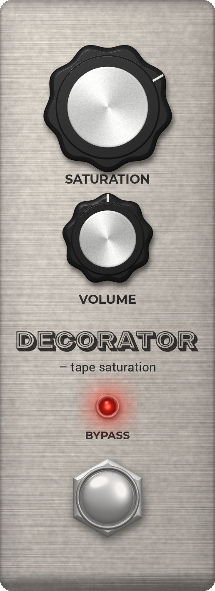

<p align="center">
  
</p>

<h1 align="center">Decorator</h1>
<p align="center"><b>Tape saturation from neural captures of a real pedal.</b><br>
AU · VST3 · standalone, macOS (Apple silicon)</p>

---

Decorator is a guitar plugin that recreates a digital tape-saturation stompbox from 2014. The pedal has two knobs on its saturation side:

- **Saturation** runs from almost clean, slightly thickened tape at 7:00 to heavy, compressed tape drive at full.
- **Volume** sets the output level.

The plugin has the same two knobs and a bypass footswitch, on a brushed-steel face.

Behind the knobs are **ten [Neural Amp Modeler](https://github.com/sdatkinson/neural-amp-modeler) A2 captures** of the real pedal. They were taken at Saturation 7:00, 8:30, 9:00, 10:00, 11:00, 12:00, 1:00, 2:00, 3:00 and 4:00, with Volume at maximum. The captures are embedded in the plugin, so there are no files to load.

## The TONE3000 version

The same ten captures are also on TONE3000 as a pack of NAM profiles: **[tone3000.com/tones/113208](https://www.tone3000.com/tones/113208)**.

| | TONE3000 pack | Decorator plugin |
|---|---|---|
| Captures | the same ten NAM A2 models | the same ten, embedded |
| Saturation | ten fixed steps: load one profile per setting | a continuous knob that crossfades neighbouring captures |
| Volume | output level fixed to roughly the pedal's Volume at 12:45 | the full Volume knob, using the measured curve |
| Runs in | any NAM host (TONE3000, NAM plugin, ...) | its own AU / VST3 / app |

At a capture position the plugin runs exactly the same model as the matching TONE3000 profile. With Volume at max (and output levels lined up), the two null below −90 dB. With Volume at about 12:40, the plugin's level is within 0.1 dB of the TONE3000 profile's. The pack is the easiest way to use one setting in a NAM rig. The plugin adds the knobs between the steps.

## Listen

<p align="center"></p>

**[▶ Open the live demo page](https://alejandrozarco.github.io/decorator/)** to play each clip and switch between the clean DI and the plugin while it keeps playing. The page can also match loudness, or add a simple speaker filter. The page source is in [`docs/`](docs/index.html). To run it locally, use `python3 -m http.server` inside `docs/`.

Or download the MP3s. Volume is at 12:00 in all of them, and the levels are real, not loudness-matched:

| Clip | Clean DI | Sat 9:00 | Sat 12:00 | Sat 3:00 | Sat max |
|---|---|---|---|---|---|
| Open chords | [▶](docs/audio/chords_off.mp3) | [▶](docs/audio/chords_sat0900.mp3) | [▶](docs/audio/chords_sat1200.mp3) | [▶](docs/audio/chords_sat0300.mp3) | [▶](docs/audio/chords_sat0500.mp3) |
| Arpeggios | [▶](docs/audio/arpeggios_off.mp3) | [▶](docs/audio/arpeggios_sat0900.mp3) | [▶](docs/audio/arpeggios_sat1200.mp3) | [▶](docs/audio/arpeggios_sat0300.mp3) | [▶](docs/audio/arpeggios_sat0500.mp3) |
| Lead line | [▶](docs/audio/lead_off.mp3) | [▶](docs/audio/lead_sat0900.mp3) | [▶](docs/audio/lead_sat1200.mp3) | [▶](docs/audio/lead_sat0300.mp3) | [▶](docs/audio/lead_sat0500.mp3) |
| Low riff | [▶](docs/audio/riff_off.mp3) | [▶](docs/audio/riff_sat0900.mp3) | [▶](docs/audio/riff_sat1200.mp3) | [▶](docs/audio/riff_sat0300.mp3) | [▶](docs/audio/riff_sat0500.mp3) |

The demo guitar is the [FreePATS "Electric Guitar FSBS (direct)"](http://freepats.zenvoid.org/ElectricGuitar/clean-electric-guitar.html) sample bank, a raw DI recording of a Fender guitar released under **CC0 1.0**. The phrases are played from that bank at a typical single-coil level of about −30 dBFS RMS, then run through the plugin alone, with no amp or cab. `demo/make_demos.py` rebuilds everything.

## How it works

- **Saturation**: between capture positions, the plugin crossfades the two neighbouring captures. Only those two run, so CPU use stays at about one model. The real pedal does nothing between 7:00 and 8:00 or between 4:00 and 5:00, and the plugin copies that. The captures' latencies (21–26 samples) are evened out so the crossfades don't comb-filter.
- **Volume**: a gain curve fitted through levels measured on the pedal at 7:00, 9:00, 12:00, 3:00 and 5:00, plus one estimated point near 10:15. 5:00 is unity relative to the captures. 12:00 is about −9.7 dB.
- **Calibration**: the captures expect a particular voltage at the input. Set **Interface dBu** in the footer to your audio interface's input level at 0 dBFS. The default is 12.5 dBu, which is a Focusrite Scarlett 3rd Gen instrument input at minimum gain. The plugin then drives the model as hard as the real pedal would be driven, and returns the result at the pedal's real output level.
- **Mono in, mono out to both channels**. 26 samples of reported latency, and the bypass path is delayed to match, so the footswitch doesn't click.

## How close is it?

These were measured against the real pedal through the same interface:

| Test | Result |
|---|---|
| Reamped DI through the pedal vs. the capture at Sat 9:00, 12:00, 3:00 (Volume max) | Difference signal −24 to −29 dB below the output, level within 0.4 dB |
| Played live, same chords clean and through the pedal, Sat max, Volume 12:00, into two different amp models | Level within 0.4 dB, EQ shape within 0.8 dB RMS (2 dB max) |
| Plugin vs. the bare NAM capture at every capture position | Nulls to −91 dB or lower, i.e. identical |

Not modelled: the pedal's other half (a tape doubler/echo), and its hiss. The real unit's noise floor is about −72 dBFS. Saturation settings between capture positions are crossfades and haven't been checked against the pedal yet.

## Build

```bash
git clone --recurse-submodules <this repo>
cd decorator
iPlug2/Dependencies/IPlug/download-iplug-sdks.sh        # VST3 SDK
cd Decorator
xcodebuild -project projects/Decorator-macOS.xcodeproj -scheme macOS-AUv2 \
  -configuration Release -arch arm64 CODE_SIGN_IDENTITY="-" CODE_SIGN_STYLE=Manual DEVELOPMENT_TEAM=""
```

Use the schemes `macOS-VST3` and `macOS-APP` for the other formats. The build copies its output to `~/Library/Audio/Plug-Ins` (AU and VST3) and `~/Applications`. Without a developer certificate the build is ad-hoc signed. That's fine on the machine that built it.

### Regenerating assets

| What | Script | Output |
|---|---|---|
| UI bitmaps (brushed steel, knobs, footswitch, LED) lit from height maps | `Decorator/scripts/render_ui.py` | `resources/img/ui_*@2x.png` |
| Embed bitmaps in the binary | `Decorator/scripts/embed_assets.py` | `DecoratorAssets.inc` |
| README / demo page images | `demo/make_images.py` | `docs/img/` |
| Demo audio | `demo/make_demos.py <FreePATS bank folder>` | `docs/audio/`, `docs/demos.json` |

Python needs `numpy scipy pillow soundfile pedalboard`, and `ffmpeg` must be installed for the audio.

## Layout

```
Decorator/                plugin source (iPlug2 project)
  Decorator.cpp/.h        DSP, crossfade, volume curve, UI
  DecoratorModels.inc     the ten captures (NAM JSON)
  DecoratorAssets.inc     pre-rendered UI bitmaps
  scripts/                UI renderer, asset embedder, iPlug2 build helpers
demo/                     scripts for the demo audio and images
docs/                     demo page, audio, images
iPlug2, NeuralAmpModelerCore, AudioDSPTools, eigen   submodules
```

## Licence

Decorator is free software under the **GNU General Public License v3.0**. See [LICENSE](LICENSE).

It's built on:
- [NeuralAmpModelerPlugin](https://github.com/sdatkinson/NeuralAmpModelerPlugin), [NeuralAmpModelerCore](https://github.com/sdatkinson/NeuralAmpModelerCore) and [AudioDSPTools](https://github.com/sdatkinson/AudioDSPTools), © Steven Atkinson, MIT. The original notice is in [LICENSE-MIT-NeuralAmpModeler.txt](LICENSE-MIT-NeuralAmpModeler.txt).
- [iPlug2](https://github.com/iPlug2/iPlug2) (zlib-style licence), [Eigen](https://eigen.tuxfamily.org) (MPL 2.0) and the VST3 SDK (MIT).
- The fonts Montserrat, Archivo Black and Michroma (SIL OFL 1.1) and Roboto (Apache 2.0).
- The demo audio source: FreePATS Electric Guitar FSBS (direct), CC0 1.0.

The pedal name and maker are left out on purpose. This project isn't affiliated with or endorsed by any pedal manufacturer.
